<div align="center">

<picture>
  <source media="(prefers-color-scheme: dark)" srcset=".github/assets/banner-dark.svg">
  
</picture>

**Bring PSR-7, PSR-15 and PSR-17 software to PAM HTTP.**<br>
Messages, factories and a middleware pipeline built on the official PHP-FIG interfaces, at an explicit interoperability boundary.

[](https://packagist.org/packages/pushinbr/pam-http-psr)

[](https://github.com/push-in/pam-http-psr/actions/workflows/ci.yml)
[](LICENSE)

[Install](#install) · [Quick example](#quick-example) · [What is inside](#whats-inside) · [Docs](#docs) · [Issues](https://github.com/push-in/pam-http-psr/issues)

</div>

<a id="install"></a>
## <picture></picture> Install

Inside a PAM project (for example one created with `pam init my-api --template http`):

```sh
pam composer require pushinbr/pam-http-psr
```

It pulls in `psr/http-message` 2.x, `psr/http-factory`, `psr/http-server-handler` and `psr/http-server-middleware`.

<a id="quick-example"></a>
## <picture></picture> Quick example

```php
<?php

declare(strict_types=1);

use Pam\Http\Psr7\Factory;
use Pam\Http\Psr15\Pipeline;
use Psr\Http\Message\ResponseInterface;
use Psr\Http\Message\ServerRequestInterface;
use Psr\Http\Server\RequestHandlerInterface;

$factory = new Factory();
$request = $factory->createServerRequest('GET', 'https://example.test/users/42');
$handler = new class($factory) implements RequestHandlerInterface {
    public function __construct(private readonly Factory $factory)
    {
    }

    public function handle(ServerRequestInterface $request): ResponseInterface
    {
        return $this->factory->createResponse(204)->withHeader('x-path', $request->getUri()->getPath());
    }
};

$response = (new Pipeline($handler))->handle($request);
```

`Pipeline` accepts a list of `MiddlewareInterface` instances or callables as its second argument and runs them in order before the handler.

<a id="what-you-can-build"></a>
## <picture></picture> What you can build

- Running PSR-15 middleware in a PAM application
- Adapting libraries that require PSR-7 values
- Migrating existing PSR-based HTTP code incrementally

| | |
| --- | --- |
| **Role** | HTTP interoperability adapter |
| **Execution path** | PHP-FIG PSR interfaces · PAM HTTP |
| **This repository owns** | Request, response, middleware, and factory implementations |
| **Boundary** | Not a server or router; conversion has a measurable boundary cost |

<a id="whats-inside"></a>
## <picture></picture> What is inside

| Namespace | Classes | Interfaces |
| --- | --- | --- |
| `Pam\Http\Psr7` | `Stream`, `Uri`, `ServerRequest`, `Request`, `Response`, `UploadedFile` | PSR-7 |
| `Pam\Http\Psr7` | `Factory` | PSR-17 (request, response, server request, stream, uploaded file, URI) |
| `Pam\Http\Psr15` | `Pipeline` | PSR-15 `RequestHandlerInterface` |

The public namespaces `Pam\Http\Psr7` and `Pam\Http\Psr15` are preserved from the earlier package names (see the [changelog](CHANGELOG.md)).

<a id="docs"></a>
## <picture></picture> Docs

- [PAM HTTP documentation](https://push-in.github.io/pam-docs/packages/http/)
- [PAM HTTP](https://github.com/push-in/pam-http)
- [Changelog](CHANGELOG.md)

<a id="pam-ecosystem"></a>
## <picture></picture> Part of the PAM ecosystem

<p align="center"><picture>
  <source media="(prefers-color-scheme: dark)" srcset=".github/assets/pam-wordmark-dark.svg">
  
</picture></p>

PAM runs PHP natively on servers, desktops and phones. This repository is one piece of it.

| [**PAM**](https://github.com/push-in/pam) | [**PAM Desktop**](https://github.com/push-in/pam-desktop) | [**PAM Native**](https://github.com/push-in/pam-native) | [**Ecosystem**](https://github.com/push-in/pam#ecosystem) |
| --- | --- | --- | --- |
| the runtime and CLI | native desktop apps in PHP | native Android and iOS apps in PHP | every official package and plugin |

<sub>Docs: [push-in.github.io/pam-docs](https://push-in.github.io/pam-docs/introduction/) · [Issues](https://github.com/push-in/pam-http-psr/issues)</sub>

<p align="center"><sub><a href="LICENSE">Apache License 2.0</a>: use, modify and distribute for any purpose, including commercially · Made in Brazil by Pushin</sub></p>
